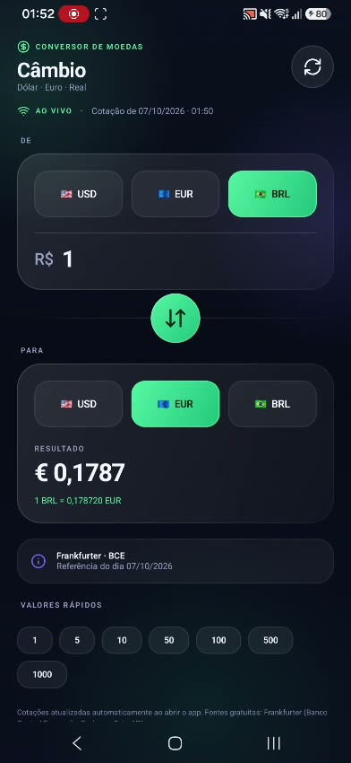

# Cambio — Conversor de Dólar, Euro e Real

Um aplicativo Android, feito em Kotlin, que mostra **quanto vale o dinheiro de um país no
dinheiro de outro país**. Por exemplo: "5 dólares valem quanto em reais?".

---

## Demonstração (vídeo)

[](app_cambio.mp4)

**Clique na imagem acima** para assistir ao vídeo do app rodando de verdade:
[`app_cambio.mp4`](app_cambio.mp4) (54 segundos, 2,5 MB).

O vídeo mostra, passo a passo:

1. a tela abrindo sozinha e buscando a cotação (selo **AO VIVO**);
2. o valor sendo digitado (`5,01`) e o resultado aparecendo na hora (`R$ 25,08`);
3. um valor maior sendo testado (`500` → `R$ 2.503,05`);
4. as moedas trocando de lugar (BRL → EUR, resultado `€ 0,1787`).

> Arquivos da demo: `app_cambio.mp4` (vídeo) e `app_cambio_poster.jpg`
> (imagem de capa, criada a partir do segundo 12 do vídeo).

---

## 1. O que esse app faz?

Imagine seu pai dizendo: "Leva 50 dólares, que hoje dá X reais". Para responder isso
rápido, você abre o Cambio, digita `50` e ele responde na hora.

Coisas que o app sabe fazer:

1. **Converter 6 combinações de moedas:**
   - Dólar (USD) → Real (BRL)
   - Real (BRL) → Dólar (USD)
   - Euro (EUR) → Real (BRL)
   - Real (BRL) → Euro (EUR)
   - Dólar (USD) → Euro (EUR)
   - Euro (EUR) → Dólar (USD)
2. **Trocar as moedas de lugar** com um toque no botão de setas (sem digitar nada de novo).
3. **Botão "valores rápidos"**: toque em 10, 50, 100 e o número aparece sozinho.
4. **Botão Atualizar**: busca a cotação de agora.
5. **Atualiza sozinho** toda vez que você abre o app.
6. **Funciona sem internet**: ele guarda a última cotação dentro do aparelho (cache) e
   mostra o aviso "CACHE LOCAL" para você saber que aquele número não é de agora agora.
7. **Sempre diz a hora** da cotação que está na tela.

O app tem 3 "selos" de status:

| Selo | Significado |
|---|---|
| AO VIVO | veio da internet agora |
| CACHE LOCAL | veio da memória do aparelho (sem internet) |
| ATUALIZANDO | está buscando, espere um segundinho |

---

## 2. De onde vêm os números?

O app **não inventa** as cotações. Ele pede para duas "estações de rádio" gratuitas
(APIs, que são sites feitos para máquinas falarem entre si):

1. **Principal:** `api.frankfurter.dev` (cotações oficiais do banco central da Europa)
2. **Reserva:** `open.er-api.com` (caso a primeira caia)

Se as duas falharem, ele usa a última cotação guardada. Ele nunca trava nem fecha
por causa de internet ruim.

---

## 3. Quais são as peças do app?

Pense num app como um sanduíche de camadas:

| Camada | Arquivo | O que faz |
|---|---|---|
| Tela | `ConverterScreen.kt` | desenha os botões, campos e cores |
| Cérebro | `ConverterViewModel.kt` | guarda o que o usuário digitou e decide o que mostrar |
| Coleta de dados | `RateRepository.kt` | conversa com a internet e guarda o cache |
| Linguagem | `Currency.kt` | lista as 3 moedas (USD, EUR, BRL) |
| Tradução de números | `MoneyFormat.kt` | transforma `1234.5` em `1.234,50` (formato brasileiro) |
| Pintura | `ui/theme/Theme.kt` | cores, degradês e fontes |

Estrutura das pastas:

```
usd-to-real/
├── .gitignore                  # o que o Git deve ignorar (nunca subir)
├── README.md                   # este arquivo
├── build.gradle.kts            # configuração geral do projeto
├── settings.gradle.kts         # nome do projeto e de onde baixar bibliotecas
├── keystore.properties         # senha da assinatura (SEGREDO, não vai para o Git)
├── keystore/cambio.jks         # chave de assinatura (SEGREDO, não vai para o Git)
└── app/
    ├── build.gradle.kts        # versão do app, bibliotecas, assinatura
    └── src/main/
        ├── java/com/cambio/converter/
        │   ├── MainActivity.kt
        │   ├── ConverterViewModel.kt
        │   ├── data/           # Currency.kt, RateRepository.kt
        │   └── ui/             # ConverterScreen.kt, MoneyFormat.kt, theme/Theme.kt
        └── res/                # ícones, textos, cores do Android
```

---

## 4. De que é feito (explicando cada um)

- **Kotlin** — a linguagem (tipo o "português" que a máquina entende). É a mais usada
  para apps Android hoje.
- **Jetpack Compose** — a forma moderna de desenhar a tela. Em vez de escrever vários
  arquivos de "layout", você descreve a tela em código e ele desenha.
- **Material 3** — o estilo visual do Android (botões, sombras, cores).
- **Ícones Lucide** — a biblioteca dos ícones (setas, wifi, recarregar).
- **Retrofit + Gson** — o "telefone" que busca a cotação na internet e entende a resposta.
- **Gradle** — o robô que monta o app (é o `./gradlew` que você roda no terminal).

---

## 5. Como rodar no computador

Você precisa ter instalado:

1. **Android Studio** (ele já traz o "SDK do Android")
2. **JDK 17** (o Android Studio já traz junto)

### Jeito fácil (Android Studio)
1. Abra o Android Studio → `File > Open` → escolha a pasta `usd-to-real`.
2. Aperte o botão verde **Run ▶** e escolha um celular emulador.

### Jeito do terminal
```bash
# App de teste (debug) — rápido, sem assinatura
./gradlew assembleDebug

# App final (release) — assinado, menor e mais rápido
./gradlew assembleRelease

# Verificar se o código tem erro
./gradlew lintDebug
```

O APK sai em:
- debug: `app/build/outputs/apk/debug/app-debug.apk`
- release: `app/build/outputs/apk/release/app-release.apk`

### Instalar no celular usando o cabo USB
```bash
# primeiro ative "Depuração USB" nas opções do desenvolvedor do celular
adb install -r app/build/outputs/apk/release/app-release.apk
```
Se o celular já tem uma versão **diferente** assinada com outra chave, primeiro
desinstale (`adb uninstall com.cambio.converter`) — senão ele reclama de assinatura.

---

## 6. A assinatura do app (o "carimbo do artista")

Para publicar ou instalar uma versão "de verdade" (release), o Android exige que o APK
tenha uma assinatura. Aqui usamos o arquivo `keystore/cambio.jks`.

**Muito importante:** senha e chave são **segredos**. Por isso eles estão no
`.gitignore` e **nunca** devem ser enviados para o GitHub. Se alguém pegar essa chave,
ela pode publicar atualizações fingindo ser o seu app.

O `app/build.gradle.kts` já faz isso de forma inteligente: se o arquivo
`keystore.properties` existir, ele assina o release; se não existir, ele apenas não
assina (e o build continua funcionando).

---

## 7. Como o app decide o que mostrar

```
usuário digita 50
      │
      ▼
ConverterScreen (tela)  ──avisa──▶  ConverterViewModel (cérebro)
                                        │
                                        ▼
                                 RateRepository (pega a cotação)
                                   │                │
                            internet OK        sem internet
                                   │                │
                          api.frankfurter     cache guardado
                                   │                │
                                   └───────┬────────┘
                                           ▼
                                  tela mostra 250,30
```

O cérebro (ViewModel) nunca trava a tela: se a internet demorar, ele mostra
"ATUALIZANDO" e você pode continuar mexendo.

---

## 8. Dicas e erros comuns

- **"Falha ao instalar: assinatura diferente"** → o celular tem outra versão. rode
  `adb uninstall com.cambio.converter` e instale de novo.
- **Ficou CACHE LOCAL o tempo todo?** → está sem internet, ou as duas APIs caíram.
  Toque em Atualizar mais tarde.
- **Quer trocar as moedas?** → toque no botão das setas no meio da tela.
- **Mudou alguma cor ou layout?** → rode `./gradlew lintDebug` antes de mandar para
  alguém, ele avisa se tem erro.
- **Número com vírgula ou ponto?** → os dois jeitos funcionam: você pode digitar
  `10,50` ou `10.50`.

---

## 9. Teste rápido depois de qualquer mudança

1. `./gradlew assembleDebug`
2. Instale no emulador/celular.
3. Confira as 6 conversões digitando valores diferentes.
4. Toque **dentro** do campo → o teclado abre.
5. Toque **fora** do campo → o teclado fecha sozinho.
6. Ligue o modo avião → abra o app → deve aparecer `CACHE LOCAL`.
